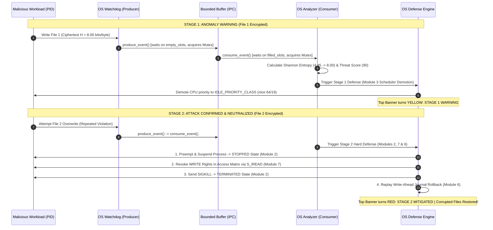

# 🎓 The Ultimate "Very Easy" Study Guide: OS-Analyzer
> **Course:** BCSE303L — Operating Systems  
> **Textbook:** *Operating System Concepts* (Silberschatz, Galvin, Gagne)  
> **Purpose:** Master everything about this project for presentations, lab exams, and viva interviews in under 20 minutes.

---

## 📑 Quick Navigation
1. [The 30-Second Elevator Pitch](#1-the-30-second-elevator-pitch)
2. [The Real-World Analogy (Explain Like I'm 5)](#2-the-real-world-analogy-explain-like-im-5)
3. [The Secret Sauce: Shannon Entropy Made Super Simple](#3-the-secret-sauce-shannon-entropy-made-super-simple)
4. [Syllabus Cheat Sheet: The 6 Modules Explained](#4-syllabus-cheat-sheet-the-6-modules-explained)
5. [The 5-Step Defense Chain (What Happens in an Attack)](#5-the-5-step-defense-chain-what-happens-in-an-attack)
6. [Code Anatomy: Which File Does What?](#6-code-anatomy-which-file-does-what)
7. [How to Demo It Live (What to Point at on Screen)](#7-how-to-demo-it-live-what-to-point-at-on-screen)
8. [Top 10 Viva Questions & Exact Answers](#8-top-10-viva-questions--exact-answers)

---

## 1. The 30-Second Elevator Pitch

> *"Traditional antivirus systems look for known file signatures or hashes. If an attacker changes even one character of a ransomware virus, its hash changes and antivirus tools miss it.*  
>  
> *Our project, **OS-Analyzer**, does not care what the file is named or what its hash is. Instead, it monitors **what the process is doing to the OS in real-time**: measuring data randomness (Shannon Entropy), disk write speed, and CPU/memory usage. When it detects rapid encryption, it uses standard OS kernel mechanisms—priority demotion, process preemption, access revocation, process termination, and journal rollback—to neutralize the attack and restore all destroyed files automatically."*

---

## 2. The Real-World Analogy (Explain Like I'm 5)

Imagine a security guard stationed inside a library archive:

| Concept | Traditional Antivirus | OS-Analyzer (Our Project) |
| :--- | :--- | :--- |
| **How it detects trouble** | Checks a printed "Wanted Criminals" mugshot poster. If the criminal wears a hat or mustache, they walk right in. | Watches the visitor's **actions**. Does not care about their face. |
| **The Trigger** | Hash mismatch = Allowed in. | The visitor starts ripping pages out of books and replacing them with encrypted gibberish at 100 pages per minute. |
| **The Reaction** | Nothing (signature wasn't on the poster). | 1. Slows them down (lower priority).<br>2. Freezes their arms (suspension).<br>3. Locks the bookshelf doors (access matrix revocation).<br>4. Kicks them out (SIGKILL).<br>5. Restores original books from the vault backup (Journal Rollback). |

---

## 3. The Secret Sauce: Shannon Entropy Made Super Simple

### What is Shannon Entropy ($H$)?
In Information Theory, **Entropy is a measure of randomness or unpredictability** in a stream of bytes.
- Value range: **$0.0$** (completely predictable) to **$8.0$** (pure white noise / total randomness).

$$H(X) = - \sum_{i=0}^{255} P(x_i) \log_2 P(x_i)$$

### The Intuitive Breakdown:
- **Plain English Text / Code / CSVs ($H \approx 3.5 - 4.5$ bits/byte):**
  English uses mostly lowercase letters (`e`, `t`, `a`, `o`), spaces, and punctuation. Many byte values (0 to 31, 128 to 255) almost never appear. Because some characters appear way more often than others, it has **low entropy**.
- **Encrypted Ciphertext ($H \approx 7.8 - 8.0$ bits/byte):**
  Good encryption (like AES or ChaCha20) scrambles data so thoroughly that every single byte value from 0 to 255 has an equal, random chance of appearing. To mathematics, encrypted data looks like **pure static / maximum entropy**.

### The Mathematical Rule Used in Code:
If a file's entropy suddenly jumps from $\approx 4.4$ to $> 7.5$, and its write speed spikes, **the process is encrypting user data.**

---

## 4. Syllabus Cheat Sheet: The 6 Modules Explained

Every single line of code was built to reflect a specific chapter of Silberschatz's *Operating System Concepts* textbook. Here is how each module is mapped:

```
┌────────────────────────────────────────────────────────────────────────┐
│                        OS-ANALYZER SYLLABUS MAP                        │
├────────────────────────────────┬───────────────────────────────────────┤
│ Module 2: OS Structures & APIs │ Process Control Block (PCB), States   │
│ Module 3: CPU Scheduling       │ Priority Demotion (nice / IDLE class) │
│ Module 4: Threads & IPC        │ Bounded-Buffer, Semaphores & Mutex    │
│ Module 5: Memory Management    │ Working Set (RSS) & Page Faults       │
│ Module 6: Storage & Filesystem │ Write-Ahead Journaling (WAL) Rollback │
│ Module 7: System Protection    │ Access Matrix & Policy vs Mechanism   │
└────────────────────────────────┴───────────────────────────────────────┘
```

### Detailed Breakdown by Module:

#### 1. Module 2 & Module 5: Process Control Block (PCB) & Working Set Memory
- **Textbook Idea:** The OS kernel keeps track of every process using a Process Control Block (PCB) containing process state, PID, PPID, registers, and memory bounds. In virtual memory, the "Working Set" is the actual RAM pages currently in physical memory (Resident Set Size - RSS).
- **In our code:** Class `ProcessControlBlockInspector` ([analyzer.py:96](file:///d:/Code%20Playground/OS-Project/analyzer.py#L96))
- **What it tracks:**
  - Standard process states: `NEW` $\to$ `READY/RUNNING` $\to$ `WAITING/STOPPED` $\to$ `TERMINATED`
  - Resident Set Size (`working_set_rss_mb`)
  - Page Fault counts (`page_faults`)
  - I/O Read and Write system call counters

#### 2. Module 4: Producer-Consumer IPC & Semaphores
- **Textbook Idea:** The classic synchronization problem: A producer thread places items into a fixed-size buffer ($N$ slots), and a consumer thread removes them. They must use **Semaphores** (`empty_slots`, `filled_slots`) and a **Mutex** lock to prevent race conditions and buffer overflow.
- **In our code:** Class `BoundedBufferEventQueue` ([analyzer.py:175](file:///d:/Code%20Playground/OS-Project/analyzer.py#L175))
- **The Primitives:**
  - **Producer Thread:** `FileMonitorHandler` (Watchdog) detects file writes on disk and calls `produce_event()`.
  - **Consumer Thread:** `OSAnalyzer` telemetry engine calls `consume_event()`.
  - **Mutex Lock (`threading.Lock`):** Protects the critical section so producer and consumer never touch the queue at the exact same instant.
  - **Semaphores:**
    - `empty_slots` initialized to 20 (counts available vacancies).
    - `filled_slots` initialized to 0 (counts waiting items).

#### 3. Module 6: Storage & File System Crash Recovery (Write-Ahead Journal)
- **Textbook Idea:** Modern filesystems (like ext4 or NTFS) prevent corruption during crashes by using a **Journal** or Write-Ahead Log (WAL). Before a file block is committed, the transaction is logged. If corruption occurs, the system replays the log to restore the last consistent state.
- **In our code:** Class `WriteAheadJournalManager` ([analyzer.py:324](file:///d:/Code%20Playground/OS-Project/analyzer.py#L324))
- **How it works:**
  1. When monitoring starts, it snapshots baseline files into `.os_journal/`.
  2. Each file's inode, size, baseline entropy, and status (`COMMITTED`) are recorded.
  3. When an unauthorized encryption occurs, the file is tagged as `DIRTY`.
  4. On mitigation, `replay_journal_recovery()` copies clean checkpoint blocks back to disk and marks files `RECOVERED`.

#### 4. Module 7 Part A: System Protection & Access Control Matrix
- **Textbook Idea:** Protection is modeled as an **Access Matrix** where Rows = Domains/Subjects (User, Monitor, Workload) and Columns = Objects (files, directories). Rights include `READ`, `WRITE`, `EXECUTE`.
- **In our code:** Class `AccessControlMatrix` ([analyzer.py:552](file:///d:/Code%20Playground/OS-Project/analyzer.py#L552))
- **The Matrix in our System:**
  - `User_Admin` $\to$ `READ, WRITE, EXECUTE`
  - `Monitor_Daemon` $\to$ `READ, WRITE, JOURNAL`
  - `Workload_Process` $\to$ Initially `READ, WRITE` $\to$ Revoked to **`READ_ONLY (WRITE REVOKED)`** via `os.chmod(S_IREAD)`.

#### 5. Module 7 Part B & Module 3: Policy vs. Mechanism & CPU Scheduling
- **Textbook Idea:**
  - **Policy:** *What* should be done? (Decisions, algorithms, thresholds).
  - **Mechanism:** *How* it is enforced? (System calls, signals, hardware controls).
- **In our code:** Class `SecurityPolicyAndMechanism` ([analyzer.py:662](file:///d:/Code%20Playground/OS-Project/analyzer.py#L662))
- **Policy Engine:** Computes a composite Threat Score ($0 - 100$):
  - Shannon Entropy $> 7.5$: $+60$ pts
  - Entropy Jump $\Delta H > 2.5$: $+30$ pts
  - Write Velocity $> 100\text{ KB/s}$: $+20$ pts
  - High CPU $> 65\%$: $+10$ pts
  - Decision: `< 40 = NORMAL`, `40-69 = THROTTLE_PRIORITY`, `>= 70 = PREEMPT_AND_RECOVER`
- **Mechanism Engine:**
  - If `THROTTLE`: Calls `psutil.nice(IDLE_PRIORITY_CLASS)` (demotes CPU time slices).
  - If `PREEMPT`: Suspends process, revokes rights, sends `SIGKILL`, and triggers journal rollback.

---

---

## 5. The Two-Stage Graduated Defense Chain (What Happens in an Attack)

When an attacker starts encrypting files, the OS Analyzer executes a **graduated two-stage defense** that directly mirrors textbook OS escalation policies:



---

## 6. Code Anatomy: Which File Does What?

The entire project is organized into 3 primary Python scripts:

| File Name | Role in the System | Key Classes Inside |
| :--- | :--- | :--- |
| [`analyzer.py`](file:///d:/Code%20Playground/OS-Project/analyzer.py) | **The Engine & Brain.** Implements all 6 OS textbook modules in separate classes. Contains the math, process inspection, semaphores, journal, and policy evaluator. | `ProcessControlBlockInspector`, `BoundedBufferEventQueue`, `WriteAheadJournalManager`, `AccessControlMatrix`, `SecurityPolicyAndMechanism`, `OSAnalyzer` |
| [`main.py`](file:///d:/Code%20Playground/OS-Project/main.py) | **The Live Dashboard (TUI).** Built using the `rich` library. Features the dynamic Top Status Banner and 4 syllabus panels with locked ratios. | `build_pcb_panel`, `build_sync_panel`, `build_journal_panel`, `build_security_panel`, `generate_layout`, `main` |
| [`mock_encryptor.py`](file:///d:/Code%20Playground/OS-Project/mock_encryptor.py) | **The Workload Simulator.** Generates test files, simulates legitimate benign app writes, or acts as a controlled ransomware encryptor. | `reset_environment`, `run_attack_simulation`, `run_normal_simulation` |

---

## 7. How to Run & Demo It Live (What to Point at on Screen)

### 📋 Complete Command Cheat Sheet

| Mode | Command Line | Description |
| :--- | :--- | :--- |
| **Option 1A (Live Attack Demo)** | `python main.py --demo attack` | **Best for Viva!** Single-command automated attack & defense demo. Paced at 1.2s per file. |
| **Option 1B (Benign Workload)** | `python main.py --demo normal` | Proves normal text writes run unhindered (0 alerts, threat score = 0). |
| **Option 2 (Manual Two-Terminal)** | *Terminal 1:* `python main.py`<br>*Terminal 2:* `python mock_encryptor.py --mode attack --delay 2` | Interactive mode: watch the monitor in Terminal 1 while triggering the attack in Terminal 2. |
| **Option 3A (Clean Environment)** | `python mock_encryptor.py --reset` | Restores `test_monitor_dir/` to 25 pristine plaintext files and clears locks. |
| **Option 3B (Module Self-Test)** | `python analyzer.py` | Direct terminal unit test validating all 6 syllabus modules. |

> [!TIP]
> **Terminal Font Size / Zoom:** If the dashboard feels large or crowded on your screen, hold **`Ctrl`** and scroll your **Mouse Wheel Down** (or press **`Ctrl` + `-`** in Windows Terminal) to zoom out and make the display sharp and compact.

---

### 🎙️ Viva Walkthrough: What You Say & Point at During `python main.py --demo attack`

1. **Point to Top Status Banner (Dynamic Header):**
   > *"Notice the real-time system status banner at the top. It starts green (`SYSTEM SECURE`). When the attack begins, it transitions to yellow (`STAGE 1: SUSPICION`) as the scheduler throttles the process, and finally red (`STAGE 2: THREAT MITIGATED`) as the attack is neutralized and files are recovered."*

2. **Point to Top-Right Panel ([Module 4] Concurrency & Semaphores):**
   > *"Watchdog acts as the producer thread, while OS-Analyzer acts as the consumer thread. They coordinate across a 20-slot bounded buffer synchronized with counting semaphores (`empty_slots`, `filled_slots`) and a mutual exclusion mutex lock."*

3. **Point to Bottom-Left Panel ([Module 6] Storage & Write-Ahead Journal):**
   > *"Notice the Shannon entropy transitions. Normal textbook files have an entropy of ~4.45 bits/byte. As the attacker overwrites them with encrypted bytes, entropy jumps to 8.00 (maximum randomness), marking the file DIRTY. When mitigation fires, the Journal replays the clean baseline and marks them RECOVERED."*

4. **Point to Top-Left Panel ([Module 2 & 5] Process Control Block & Memory):**
   > *"The PCB tracks the offending process in real-time. Notice its CPU Scheduling Nice value demote to `64 (THROTTLED/IDLE)`, its Working Set memory, and its textbook state change from `READY/RUNNING` $\to$ `WAITING/STOPPED` $\to$ `TERMINATED (SIGKILL)`."*

5. **Point to Bottom-Right Panel ([Module 7 & 3] Protection & Mitigations):**
   > *"Our Security Policy cleanly separates policy from mechanism. It flags the threat, demotes CPU nice priority (Module 3), suspends the thread (Module 2), revokes write access in the Access Control Matrix (Module 7), issues SIGKILL, and replays the Write-Ahead Journal to guarantee zero data loss (Module 6)."*

---

## 8. Top 10 Viva Questions & Exact Answers

### Q1: Why use behavioral detection instead of hash/signature matching?
**Answer:** Signature detection only identifies threats that have already been seen and hashed before. If an attacker tweaks one byte of code or recompiles it, the hash changes completely. Behavioral detection looks at what the program does at runtime (high entropy overwrites + high I/O velocity), allowing it to catch zero-day attacks.

### Q2: What is Shannon Entropy and what are its minimum and maximum values?
**Answer:** Shannon Entropy measures the average uncertainty or information density per byte. For an 8-bit byte ($2^8 = 256$ possibilities), the minimum is **0.0** (all bytes are identical) and the maximum is **8.0** (all 256 byte values appear with equal probability, representing perfect randomness).

### Q3: Can a legitimate file have high entropy? How do you prevent false positives?
**Answer:** Yes! Compressed archives (`.zip`) or media (`.mp4`, `.jpg`) already have high entropy. Our system avoids false positives using a multi-factor **Security Policy**:
1. It tracks **Entropy Delta ($\Delta H$)** — did this existing file's entropy suddenly leap from 4.4 to 7.9?
2. It measures **I/O write burst velocity** ($> 100$ KB/s across multiple files).
3. It correlates **CPU utilization spikes**.

### Q4: How does your Producer-Consumer queue prevent race conditions?
**Answer:** It uses classic Silberschatz concurrency primitives:
- An **`empty_slots` Semaphore** (initialized to capacity $N=20$)
- A **`filled_slots` Semaphore** (initialized to $0$)
- A **Mutex Lock** (`threading.Lock`) that guarantees mutual exclusion inside the critical section during queue insertion and removal.

### Q5: What is the difference between Security Policy and Security Mechanism?
**Answer:**
- **Policy:** The decision logic (*"If entropy $> 7.5$ and write rate $> 100$ KB/s, then declare threat level PREEMPT_AND_RECOVER"*).
- **Mechanism:** The OS execution tool (*"Call `proc.suspend()`, `os.chmod()`, `proc.kill()`, and replay journal"*).  
Separating them allows the OS security rules to be reconfigured without changing the underlying kernel hooks.

### Q6: How does Process Suspension differ from Process Termination?
**Answer:**
- **Suspension (`STOPPED / WAITING`):** Freezes the process execution without destroying its memory address space or file descriptors. This immediately stops ongoing file damage while allowing forensic memory dumps.
- **Termination (`TERMINATED`):** Sends `SIGKILL`, completely releasing the PCB, virtual memory pages, and OS resources.

### Q7: What is Write-Ahead Logging (WAL) and how does it guarantee recovery?
**Answer:** In Write-Ahead Logging, before any transaction modifies disk state, the baseline state and transaction intent are safely recorded in a persistent journal (`.os_journal/`). If an unauthorized modification occurs, the journal recovery routine replays the logged baseline blocks to restore the files to their pre-attack state.

### Q8: What does Resident Set Size (RSS) represent in Memory Management?
**Answer:** RSS is the portion of a process's virtual memory that is currently held in physical RAM (frames), rather than swapped out to disk. It represents the active Working Set of the process.

### Q9: How is the Access Control Matrix enforced in this project?
**Answer:** The Access Control Matrix defines permissions (Read/Write/Execute) for Domains over Objects. When a process violates policy, the matrix transitions the workload's rights from `READ, WRITE` to `READ_ONLY`, and the mechanism applies an OS-level read-only attribute (`stat.S_IREAD`) to the files via `os.chmod`.

### Q10: Why use a Bounded Buffer rather than an unbounded Python list?
**Answer:** An unbounded queue can lead to resource exhaustion if file events are generated faster than the consumer can process them, leading to thrashing or out-of-memory crashes. A Bounded Buffer enforces flow control by blocking the producer thread when the buffer reaches capacity ($N=20$).

---

## 💡 Quick Tips for the Viva
- Speak with confidence: Remember that every feature maps directly to your textbook.
- Use textbook terminology: Say *"Process Control Block"*, *"Working Set"*, *"Counting Semaphore"*, *"Access Control Matrix"*, and *"Write-Ahead Logging"*.
- If the professor asks to verify the math, show them the function [calculate_entropy()](file:///d:/Code%20Playground/OS-Project/analyzer.py#L50) in `analyzer.py`.
